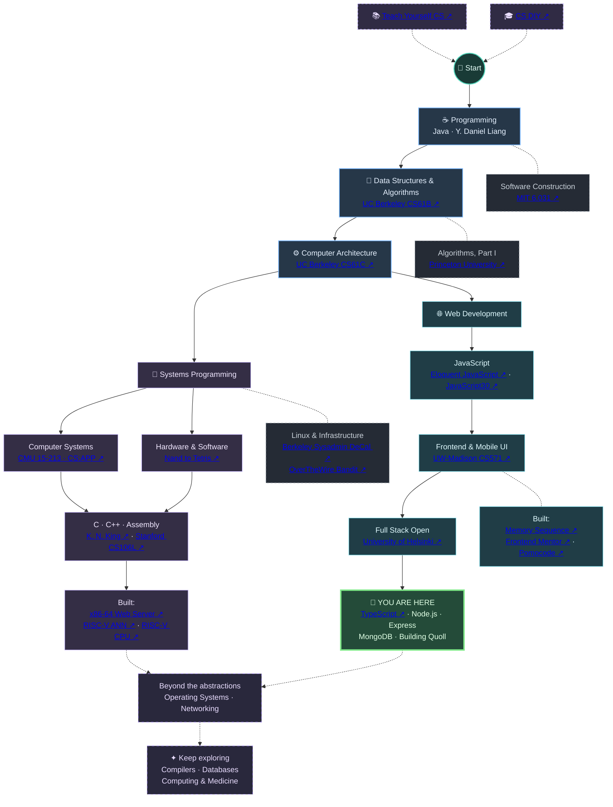

<h1 align="center">Hassan </h1>

  

  <a href="#projects">Projects</a> ·
  <a href="#my-learning-journey">Journey</a> ·
  <a href="#technologies">Technologies</a> ·
  <a href="#on-my-workbench">Workbench</a> ·
  <a href="#github-activity">Activity</a> ·
  <a href="#elsewhere">Elsewhere</a>

I'm a self-taught computer science student and an MBBS candidate based on Saudi Arabia. I build applications, study computer systems, and enjoy understanding the things that feel like magic until you look beneath the abstractions.

My interests stretch from responsive interfaces to assembly language and computer architecture. I'm also curious about where computing and medicine meet.

---

## Projects 

A selection of applications, systems, and experiments I've built while learning computer science.

### ⚙️ Systems & computer architecture

| Project                                                                                                                     | Under the hood                                                                                        |
| :-------------------------------------------------------------------------------------------------------------------------- | :---------------------------------------------------------------------------------------------------- |
| **[x86-64 Web Server](https://github.com/HsHs-dev/x86-64-webserver)**   Assembly · Linux                      | Concurrent HTTP server using Linux syscalls directly, with `fork`-based connections and no libc.      |
| **[Gitlet](https://github.com/HsHs-dev/gitlet)**   Java · Data structures                                     | Git-inspired version control with content-addressed storage, snapshots, branching, and merging.       |
| **[RISC-V Neural Network](https://github.com/HsHs-dev/RISCV-ANN)**   RISC-V Assembly                          | MNIST digit classifier implementing matrix operations, ReLU, and argmax with pretrained weights.      |
| **[RISC-V CPU](https://github.com/HsHs-dev/UCB-CS61C/tree/main/Project/proj3)**   Logisim · Digital logic     | RISC-V processor featuring an ALU, register file, immediate generation, and initial pipelining.       |
| **[Hack Assembler & VM Translator](https://github.com/HsHs-dev/From-Nand-to-Tetris)**   Java · Nand to Tetris | An assembler and stack-based VM translator exploring how higher-level instructions reach the machine. |
| **[UART with termios](https://github.com/HsHs-dev/riscv-uart-termios)**   C · Linux                           | Serial-port communication utility with a virtual-terminal test harness.                               |

### 🌐 Applications & full-stack development

| Project                                                                                                                                                                                                            | Under the hood                                                                                                      |
| :----------------------------------------------------------------------------------------------------------------------------------------------------------------------------------------------------------------- | :------------------------------------------------------------------------------------------------------------------ |
| **[Memory Sequence](https://hshs-dev.github.io/react-memory-game/)** · [Source](https://github.com/HsHs-dev/react-memory-game)   React · Tailwind · Motion                                           | Interactive memory game with a finite-state game loop, Web Audio effects, and an online leaderboard.                |
| **[Phonebook](https://github.com/HsHs-dev/phonebook-app)** · [Demo](https://phonebook-app-05ao.onrender.com/)   Node.js · Express · MongoDB                                                          | Deployed full-stack exercise featuring a REST API, document persistence, and a served frontend.                     |
| **[Brutal Tomato](https://brutal-tomato.netlify.app/)** · [Source](https://github.com/HsHs-dev/brutal-tomato)   React · Tailwind                                                                     | Neobrutalist Pomodoro interface focused on responsive design, accessibility, and visual identity. Static prototype. |
| **[Frontend Mentor Gallery](https://hshs-dev.github.io/frontend-mentors-challenges-gallery/)** · [Source](https://github.com/HsHs-dev/frontend-mentors-challenges-gallery)   HTML · CSS · JavaScript | Collection of design-to-code challenges exploring responsive layouts and frontend fundamentals.                     |

### 🛠️ Developer tools & experiments

| Project                                                                                                            | Under the hood                                                                                     |
| :----------------------------------------------------------------------------------------------------------------- | :------------------------------------------------------------------------------------------------- |
| **[Pomocode](https://github.com/HsHs-dev/pomocode)**   JavaScript · VS Code API                      | Lightweight VS Code extension with status-bar timer controls, focus sessions, and break reminders. |
| **[Neovim Configuration](https://github.com/HsHs-dev/nvim-config)**   Lua · Neovim                   | Personal development environment with LSP, debugging, and editor tooling.                          |
| **[3D Projection in LÖVE2D](https://github.com/HsHs-dev/tsoding-formula)**   Lua · Computer graphics | Experiment with projecting and animating three-dimensional objects onto a two-dimensional screen.  |

  
   
  A little 3D projection experiment, written in Lua.

---

---

## My Learning Journey

A self-directed journey through computer science — from writing my first programs to understanding the systems beneath them.

### 🧭 My guiding resources

Much of my computer science education has been inspired and guided by two exceptional resources:

<table>
  <tr>
    <td width="50%">
      <strong>📚 <a href="https://teachyourselfcs.com/">Teach Yourself CS</a></strong>
        
      My compass for understanding what truly matters in computer science. It has shaped my belief in learning the fundamentals before the abstractions, and in pursuing knowledge that outlasts any particular technology.
    </td>
    <td width="50%">
      <strong>🎓 <a href="https://csdiy.wiki/en/">CS DIY</a></strong>
        
      An invaluable collection of university courses, textbooks, and hands-on learning resources. It has helped me navigate the vast landscape of computer science and discover some of the best educational material available.
    </td>
  </tr>
</table>

I'm deeply grateful to the people behind these resources for making high-quality computer science education accessible to anyone with curiosity and the willingness to learn.

### The path so far

A map of my learning, not a finished checklist. Some paths overlap, some are still being explored, and there is always more to discover.

### 📖 Explore my coursework

| Area                             | Resources & repositories                                                                                                                                         |
| :------------------------------- | :--------------------------------------------------------------------------------------------------------------------------------------------------------------- |
| **Programming foundations**      | Java by Y. Daniel Liang                                                                                                                                          |
| **Data structures & algorithms** | [Berkeley CS61B](https://github.com/HsHs-dev/UCB-CS61B) · [Princeton Algorithms](https://github.com/HsHs-dev/Algorithms)                                         |
| **Software engineering**         | [MIT 6.031](https://github.com/HsHs-dev/MIT-Software-Construction-6.031)                                                                                         |
| **Computer architecture**        | [Berkeley CS61C](https://github.com/HsHs-dev/UCB-CS61C) · [Nand to Tetris](https://github.com/HsHs-dev/From-Nand-to-Tetris)                                      |
| **Computer systems**             | [CMU 15-213 / CS:APP](https://github.com/HsHs-dev/ICS-15-213-2015)                                                                                               |
| **C & C++**                      | [C Programming: A Modern Approach](https://github.com/HsHs-dev/C-Programming-A-Modern-Approach) · [Stanford CS106L](https://github.com/HsHs-dev/Stanford-CS106L) |
| **Linux & infrastructure**       | [Sysadmin DeCal](https://github.com/HsHs-dev/SysadminDeCal) · [OverTheWire Bandit](https://github.com/HsHs-dev/overthewire-bandit)                               |
| **JavaScript**                   | [Eloquent JavaScript](https://eloquentjavascript.net/) · [JavaScript30](https://github.com/HsHs-dev/javascript30)                                                |
| **Frontend & mobile**            | [UW-Madison CS571](https://github.com/HsHs-dev/UW-Madison-CS571)                                                                                                 |
| **Full-stack development**       | [Full Stack Open](https://github.com/HsHs-dev/fullstack-open) · [TypeScript](https://github.com/HsHs-dev/Typescript-Full-Stack-Open)                             |

---

## Technologies 

  <strong>Systems & languages</strong> 
  
  
  
  
  
  
  
  
  

  <strong>Web & mobile</strong> 
  
  
  
  
  
  
  
  
  
  
  

  <strong>Backend & data</strong> 
  
  
  
  
  

  <strong>Tools & platforms</strong> 
  
  
  
  
  
  
  
  
  

---

## On my workbench

- **Building:** Quoll — a cross-platform desktop app exploring the features of `yt-dlp` (early prototype).
- **Learning:** TypeScript and full-stack development through [Full Stack Open](https://github.com/HsHs-dev/Typescript-Full-Stack-Open).
- **Exploring:** Operating systems, computer architecture, and low-level programming.

---

## GitHub activity 

  <picture>
    <source media="(prefers-color-scheme: dark)" srcset="./assets/overview.dark.svg" />
    
  </picture>

  <picture>
    <source media="(prefers-color-scheme: dark)" srcset="./assets/contributions.dark.svg" />
    
  </picture>

Statistics refreshed daily with GitHub Actions and stored directly in this repository.

---

## Elsewhere

  
  
  

---

> _“The constraints imposed in building large software systems are the limitations of our own minds”_
>
> — Harold Abelson
